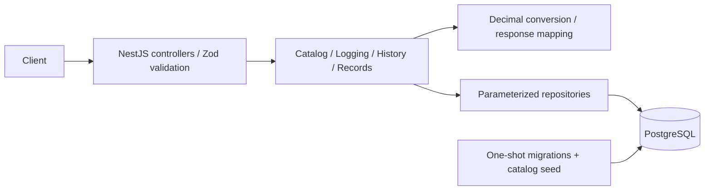

# Everfit Workout Logging API

The NestJS/PostgreSQL API supports exercise discovery, atomic workout logging, filtered history, and personal records with period comparisons. Includes concurrency and performance verification, automatic Docker initialization, and a public HTTP smoke check. [Delivery evidence](docs/delivery-verification.md), [AI workflow](AI_WORKFLOW.md), and the [19-minute video outline](docs/video-walkthrough-outline.md) accompany the implementation. The actual video recording and repository publication remain submission steps.

## Architecture



Controllers validate HTTP contracts; services own transactions and calculations; repositories own SQL. PostgreSQL provides atomic bulk writes, user/key uniqueness, relational constraints, and on-demand record selection. Direct `pg` queries keep those guarantees visible. CSV imports use a durable PostgreSQL job queue and one separate worker. There is no ORM, external queue service, cache, or authentication; the supplied user ID selects data and does not establish identity.

## Local startup

Requires Docker with Compose. Copy the example and replace its password in all three locations (`POSTGRES_PASSWORD` and both URLs):

```sh
cp .env.example .env
# Edit .env. Use a URL-safe password for Compose (letters/digits/hyphen/underscore).
docker compose up --build -d
curl http://localhost:3000/health
```

Compose waits for PostgreSQL, then its one-shot `migrate` service applies migrations and seeds the catalog before starting the API as the non-root `node` user. Both initialization and the API use the same image with production dependencies; the seed is compiled during the image build. PostgreSQL data lives in the named `postgres-data` volume. Both published ports bind to localhost; the database port is published for host development and integration tests. Remove that mapping when host database access is unnecessary. `docker compose down` retains data. Do not remove volumes unless their data is disposable.

For host development, install Node **24.21.0** and pnpm **12.9.1**, then:

```sh
pnpm install --frozen-lockfile
docker compose up postgres -d
pnpm db:migrate
pnpm db:seed
pnpm start:dev
```

Verify every public feature after startup (requires the host Node/pnpm install above):

```sh
pnpm smoke --base-url http://localhost:3000
```

Smoke writes four entries under a new random `smoke-…` user; run against a disposable/local environment. It checks catalog, single/bulk logging, replay/conflict, rollback/key reuse, filtered history, pagination, unit conversion, records/comparison, malformed input, and empty ranges. See [delivery verification](docs/delivery-verification.md) for restart and isolated clean-start commands.

For the compiled host application, use `pnpm build && pnpm start`. Scripts load `.env` using Node; existing environment variables take precedence. If changing `POSTGRES_PORT`, update both host URLs. Compose uses its internal PostgreSQL hostname and fixed port.

## Catalog and development Swagger

Compose seeds automatically. For host development, run `pnpm db:seed` after migrations to load `data/exercise-catalog.json` into the database selected by `DATABASE_URL`. The host seed command requires development dependencies (`ts-node`); Docker runs the compiled copy. To repeat initialization without recreating API containers, use `docker compose run --rm migrate`. It reapplies catalog configuration and performs no workout deletion. Seeding is transactional and repeatable. UUIDs are canonicalized before duplicate validation, so case-variant IDs cannot overwrite one another. NUL characters are rejected in exercise and muscle-group names. Stable exercise IDs preserve history; listed exercises receive the configured names and muscle-group mappings. Unlisted exercises and existing groups remain intact.

```sh
curl 'http://localhost:3000/exercises?muscleGroup=chest&limit=1'
# Pass the returned pagination.nextCursor to fetch the next page:
curl --get http://localhost:3000/exercises --data-urlencode 'muscleGroup=chest' --data-urlencode 'limit=20' --data-urlencode 'cursor=RETURNED_CURSOR'
```

The response is `{ "data": [{ "id": "…", "name": "Bench Press", "muscleGroups": ["chest", "triceps"] }], "pagination": { "nextCursor": "…", "hasMore": true } }`. Pagination is opt-in per route; `/exercises` explicitly accepts `@Query() query: ExerciseListQueryDto` and returns `CursorPage<ExerciseDto>`. The route DTO extends the shared pagination schema with optional `muscleGroup`: exact matching after trimming/lowercasing, 1–80 characters, no NUL. Unknown groups return an empty page. Each matching exercise retains all its muscle groups. `limit` defaults to 20, accepts canonical positive decimal integers, and is capped at 100. `cursor` is optional on the first page; use the returned opaque token on later pages. Empty/final pages return `nextCursor: null` and `hasMore: false`; an unseeded catalog also returns `data: []`. Malformed/oversized cursors, duplicate query parameters, invalid limits, and unknown query fields return 400 through the global validation pipe/filter.

This changes the previous full-catalog contract: clients must follow `pagination.nextCursor` while `hasMore` is true. Ordering remains normalized name (`C` collation), then UUID ascending. PostgreSQL seeks after the last returned tuple and reads at most `limit + 1` exercises before joining muscle groups. Migration `003-exercise-cursor-index.cjs` adds the matching index; run `pnpm db:migrate` before starting an existing installation. Cursors are bound to the normalized `muscleGroup`; send the same filter on subsequent pages. Changing or removing the filter requires starting without a cursor. Older cursors without a filter binding remain valid only for unfiltered requests. Page size can change between pages. Tokens contain versioned, resource-scoped base64url JSON and are capped at 4,096 characters; they are neither encrypted nor authorization credentials. Traversal is not a snapshot: inserts before the cursor require a fresh first page, and renaming exercises during traversal may skip or repeat them. Deleting the boundary exercise does not invalidate its cursor.

Fixtures include Bench Press, Squat, Deadlift, and Push Up; zero weight is supported for every exercise. Exact lookup uses JavaScript trim/lowercase consistently for stored names and requests; internal whitespace and aliases remain distinct. Migration `002-catalog-name-normalization.cjs` backfills existing names and retains the unique index while removing PostgreSQL’s conflicting Unicode lowercase check. The normalized column is text to allow lowercase character expansion; display names remain limited to 200 characters.

With `NODE_ENV=development` (the host default), Swagger UI is at [localhost:3000/docs](http://localhost:3000/docs), and OpenAPI JSON is at `/docs-json`. Both routes and Swagger assets are disabled in `test` and `production`. Compose honors `NODE_ENV` from the environment or `.env`, defaulting to production when unset. The provided `.env.example` selects development for local Swagger; use `NODE_ENV=production docker compose up --build -d` to disable it. The clean delivery verification runs production mode. Documentation exposes health, catalog, single/bulk logging, history, and personal-record endpoints, with request, header, and response/error schemas. `ZodResponse` and the shared serializer enforce declared response contracts at runtime. Add each later endpoint’s DTOs and response decorators alongside its implementation.

Pagination contracts live in `src/schemas/pagination.schema.ts`; the reusable Zod DTO is `src/common/cursor-pagination-query.dto.ts`. A route with feature filters extends `CursorPaginationQuerySchema` and creates its own Zod DTO: `ExerciseListQuerySchema` adds `muscleGroup`, so Swagger includes it alongside `limit` and optional `cursor`. Routes needing only pagination can use `CursorPaginationQueryDto` directly. A paginated route declares its query DTO and a concrete response DTO built from `CursorPageSchema(ItemSchema)`, then uses `@ZodResponse` for that DTO. The exercises service validates its own cursor resource/version/tuple and filter binding before querying. To opt out, use the route's ordinary query/response contracts and corresponding service read; there is no global pagination registration or Swagger parameter-hiding mechanism. `/health` declares no pagination DTO, has no cursor/limit parameters in Swagger, and returns its ordinary health response.

Unit conversion uses decimal.js with 50 significant digits: `1 lb = 0.45359237 kg`. Inputs are finite JSON numbers from 0–1,000,000 with at most six decimal places; normalized kg retains fourteen decimals. Output weights use four-decimal strings with half-up rounding, originals six-decimal strings. For example, 135 lb normalizes to `61.23496995000000` kg and displays as `61.2350` kg. Workout schemas already enforce strict shapes, UTC calendar timestamps through milliseconds, reps 1–10,000, 100 sets/entry, 100 entries/bulk, and 1,000 sets/request; logging routes enforce these before acquiring a transaction.

## Atomic workout logging

`POST /users/:userId/workout-entries` creates one entry; `POST /users/:userId/workout-entries/bulk` accepts `{ "entries": [...] }` and creates the entire batch atomically. Both require exactly one `Idempotency-Key` header and return 201 with `{ "data": entry }` or `{ "data": [entry, ...] }` in request order.

```sh
curl -X POST http://localhost:3000/users/client-1/workout-entries \
  -H 'Content-Type: application/json' \
  -H 'Idempotency-Key: workout-20261009-1' \
  -d '{"date":"2026-10-09T08:00:00Z","exerciseName":"Bench Press","sets":[{"reps":5,"weight":135,"unit":"lb"}]}'
```

Bulk example (all entries succeed or none do):

```sh
curl -X POST http://localhost:3000/users/client-1/workout-entries/bulk \
  -H 'Content-Type: application/json' \
  -H 'Idempotency-Key: workout-20261009-bulk-1' \
  -d '{"entries":[{"date":"2026-10-01T08:00:00Z","exerciseName":"Bench Press","sets":[{"reps":8,"weight":60,"unit":"kg"}]},{"date":"2026-10-09T08:00:00Z","exerciseName":"Squat","sets":[{"reps":5,"weight":80,"unit":"kg"}]}]}'
```

Returns `201 {"data":[…]}` in request order, using the same entry shape as single logging. Replace an exercise with `Unknown Exercise` using a fresh key to receive 400 and verify history is unchanged. Repeat the original request/key to replay; change a weight with that key to receive `409 IDEMPOTENCY_CONFLICT`.

Each entry returns its UUID, `userId`, UTC `date`/`createdAt`, exercise `{id, name, muscleGroups}`, and ordered sets. Each set includes UUID, 1-based `position`, `reps`, `weight: "61.2350"`, `unit: "kg"`, `originalWeight: "135.000000"`, and `originalUnit: "lb"` for the example. Exact normalized kg remains internal. The initialized catalog is required; lookup trims/lowercases names without changing stored fingerprints. Unknown exercises return 400 with indexed paths such as `entries.1.exerciseName`; nothing is written.

`userId` is case-sensitive, 1–128 letters/digits/underscores/hyphens. Keys are case-sensitive, 1–128 printable non-whitespace ASCII characters. Duplicate key headers, malformed bodies, unknown fields, numeric strings, unsupported units, and exceeded limits return 400 before opening a transaction. Authentication remains outside assignment scope: a supplied user ID selects data; it is not proof of identity.

Keys are scoped to the user and shared across both POST routes, with no automatic expiry. Retry the same request with the same key: a matching request replays the committed 201 response, including original IDs and catalog metadata, after app restart or catalog rename. JSON object key order and numeric formatting do not affect matching; array order, string whitespace/casing, weight/unit, date spelling, and operation do. Different payloads or routes with the same user/key return 409. Distinct keys allow otherwise identical workouts.

The service uses one READ COMMITTED transaction for reservation, catalog resolution, batched entry/set inserts, response validation, and replay storage. A unique `(user_id, key)` constraint coordinates concurrent clients. Replay is read in a separate statement after reservation contention resolves. All failures roll back; success returns only after commit. Lock/statement timeouts and transient connection failures return sanitized 503 without automatic write retries. If a connection fails around commit, reuse the same key to resolve the uncertain outcome. Idempotency keys, bodies, and raw errors are excluded from logs.

## Workout history

`GET /users/:userId/workout-entries` returns `{data: WorkoutEntry[], pagination: {nextCursor, hasMore}, message}`. It accepts optional `exerciseName`, `muscleGroup`, `from`, `to`, `unit`, `limit`, and `cursor`. No idempotency header is required.

```sh
curl --get http://localhost:3000/users/client-1/workout-entries \
  --data-urlencode 'exerciseName=bench' \
  --data-urlencode 'muscleGroup=chest' \
  --data-urlencode 'from=2026-10-01T00:00:00Z' \
  --data-urlencode 'to=2026-11-01T00:00:00Z' \
  --data-urlencode 'unit=lb' \
  --data-urlencode 'limit=20'
```

Exercise names use trimmed, case-insensitive literal substring matching (1–200 characters); `%`, `_`, backslash, and SQL-looking text are ordinary search characters. Muscle groups use trimmed, case-insensitive exact matching (1–80 characters). Both reject NUL. Filters compose and preserve each exercise's complete muscle-group list. Unknown names/groups return an empty 200 response. Ranges accept valid UTC `Z` timestamps through milliseconds: `from` is inclusive, `to` exclusive, either bound may be omitted, and both together require `from < to`. Unknown/duplicate parameters and invalid values return structured 400 errors.

Weights default to `kg`; `unit=lb` converts from exact stored kg using the shared four-decimal rounding rule. Every set retains its six-decimal `originalWeight` and `originalUnit`. Results use current catalog names/groups; creation retries retain their original committed response metadata.

Entries sort by workout date descending, then UUID descending. Default page size is 20, maximum 100. PostgreSQL selects at most `limit + 1` entries before one bounded follow-up query retrieves all ordered sets for the returned page. Multi-group exercises appear once; sets never split across pages. Empty results return `data: []`, `pagination: {nextCursor: null, hasMore: false}`, and `message: "No workout entries found for the requested filters."`; nonempty results use `message: null`.

For subsequent pages, send `pagination.nextCursor` with the same user and normalized filters, including unit. Page size may change. Equivalent timestamp spellings bind to the same instant. Changing/removing filters requires starting without a cursor. Tokens are versioned base64url JSON, limited to 4,096 characters, with validated dates/UUIDs and a SHA-256 digest scoped to workout history. They are neither encrypted nor signed, and provide no authorization; the validated route user always scopes SQL.

Traversal is not a snapshot. Concurrent entries newer than the cursor appear after refreshing the first page; backdated entries after the cursor may appear on later pages. Already-returned entries do not repeat under append-only writes. Catalog edits may change which entries match name/group filters during traversal. Representative history timings and query-plan analysis are recorded in [read performance](docs/read-performance.md).

## Personal records and period comparisons

`GET /users/:userId/personal-records` requires `exerciseName`, matched exactly after trimming/lowercasing. Optional `from` (inclusive), `to` (exclusive), and `unit` (`kg` by default, or `lb`) follow history's UTC validation. Either bound may be omitted. Unknown exercises return structured 400; a known exercise without matching workouts returns 200 with all records null and `message: "No workout entries found for the requested exercise and range."`.

```sh
curl --get http://localhost:3000/users/client-1/personal-records \
  --data-urlencode 'exerciseName=Bench Press' \
  --data-urlencode 'unit=kg'

curl --get http://localhost:3000/users/client-1/personal-records/compare \
  --data-urlencode 'exerciseName=Bench Press' \
  --data-urlencode 'baselineFrom=2026-09-01T00:00:00Z' \
  --data-urlencode 'baselineTo=2026-10-01T00:00:00Z' \
  --data-urlencode 'comparisonFrom=2026-10-01T00:00:00Z' \
  --data-urlencode 'comparisonTo=2026-11-01T00:00:00Z'
```

Standard response: `{data: {heaviestSet, highestVolumeSet, estimatedOneRepMax}, message}`. Each non-null record contains `{value, unit, achievedAt, entryId, setPosition, reps, weight, weightUnit}`. Values and originating set weights are four-decimal strings in the requested unit; volume uses `kg*reps` or `lb*reps`. `achievedAt` is the workout timestamp, and `setPosition` is 1-based. Nonempty results have `message: null`; zero-weight workouts produce real zero records.

Each metric chooses its own set: maximum weight, maximum `weight × reps`, and maximum Epley `weight × (1 + reps / 30)`. The formula applies literally even to one rep. PostgreSQL ranks exact canonical kg values (the exact numerator for Epley) before display rounding. Ties select the earliest workout timestamp, then ascending entry UUID, then ascending set position. For sets of 100 kg × 1, 60 kg × 20, and 90 kg × 8, the winners are respectively `100.0000` kg, `1200.0000` kg*reps, and `114.0000` kg.

Comparison requires all four range bounds shown above, with start before end for each period. Overlap is allowed. Response: `{data: {baseline: {range: {from, to}, records, message}, comparison: {range: {from, to}, records, message}, differences: {heaviestSet, highestVolumeSet, estimatedOneRepMax}}}`. Each difference is null if either record is missing, otherwise `{value, unit}` for comparison minus baseline. Differences are calculated before rounding and conversion; negative differences are supported, rounded negative zero is normalized to `0.0000`. Comparing 60 kg × 8 with 70 kg × 8 yields `10.0000`, `80.0000`, and `12.6667`. No percentage metric is returned.

A separate exact catalog lookup resolves the stable exercise ID; one parameterized SQL statement selects all winners for both periods from the same database snapshot, returning at most six rows. Standard reads return at most three rows. The API never loads full workout history for record selection. Unknown/duplicate parameters, pagination parameters, invalid user IDs, and malformed ranges return 400; database timeouts/unavailability return sanitized 503. No idempotency header is required. Large-range timings and query-plan analysis are recorded in [read performance](docs/read-performance.md).

## Configuration

| Variable                  | Default / constraint                                  |
| ------------------------- | ----------------------------------------------------- |
| `DATABASE_URL`            | Required PostgreSQL URL with host and database name   |
| `PORT`                    | 3000; integer 1–65535                                 |
| `NODE_ENV`                | `development`; `development`, `test`, or `production` |
| `LOG_LEVEL`               | `info`; Pino levels or `silent`                       |
| `DB_POOL_MAX`             | 10; integer 1–100                                     |
| `DB_STATEMENT_TIMEOUT_MS` | 5000; integer 1–300000                                |
| `DB_LOCK_TIMEOUT_MS`      | 3000; integer 1–300000                                |
| `TEST_DATABASE_ADMIN_URL` | Test-only admin connection with CREATEDB permission   |

Invalid configuration stops startup before listening and reports field names without values. Pool acquisition/connect timeout is 3 seconds; idle connections expire after 30 seconds. Database sessions use UTC. No global NUMERIC parser is registered: decimal values remain strings.

## Architecture and schema

`AppModule` imports configuration, logging, database, health, exercises, workouts, and personal-records modules. The catalog follows `ExercisesController → ExercisesService → ExercisesRepository`: the controller declares HTTP contracts, the service maps public responses and normalizes lookup names, and the repository executes SQL. Only `ExercisesService` is exported for other features; `resolveNames(client, names)` reuses the caller’s transaction client. The database service owns one bounded pool; transactions use one checked-out client and always release it. A failed rollback destroys that client. Shutdown hooks close the pool. `src/schemas/` owns Zod contracts; API DTOs use strict Zod objects and the global validation pipe.

PostgreSQL fits the required relationships, atomic bulk operations, uniqueness constraints, and future analytical queries. Migration `001-workout-schema.cjs` creates:

- `exercises`, `muscle_groups`, and `exercise_muscle_groups` for configurable catalog metadata.
- `workout_entries` with user/exercise IDs and UTC timestamps; concurrent same-time entries are permitted.
- `workout_sets` with ordered positions, reps, original `numeric(13,6)` weight/unit, and normalized `numeric(24,14)` kg.
- `idempotency_requests` with a user/key primary key and committed response storage for replay.

| Index / constraint                                               | Query or invariant                                         |
| ---------------------------------------------------------------- | ---------------------------------------------------------- |
| Entries `(user_id, performed_at DESC, id DESC)`                  | Stable descending history seek                             |
| Entries `(user_id, exercise_id, performed_at DESC, id DESC)`     | Exact exercise/range filtering and record candidates       |
| Sets unique `(entry_id, position)`                               | Ordered complete sets and no repeated position             |
| Exercises unique `normalized_name`                               | Exact case-insensitive lookup                              |
| `exercises_cursor_idx` on `(normalized_name COLLATE "C", id)`    | Catalog keyset traversal                                   |
| Mapping primary key and reverse `(muscle_group_id, exercise_id)` | Complete groups and `EXISTS` filtering without duplication |
| Idempotency primary key `(user_id, key)`                         | Concurrent reservation and persisted replay                |

Foreign keys prevent catalog deletion from removing historical data. Constraints enforce bounds and uniqueness. Shared workout schemas validate supported units and decimal input precision for logging; PostgreSQL NUMERIC itself rounds excess scale.

`pnpm db:migrate` applies pending migrations under the migration runner's lock/transaction; repeating it is a no-op. `pnpm db:rollback` permits only isolated `everfit_test_<32 hex>` database names. Never manually run destructive migration APIs against a database with valuable data.

## Health and errors

`GET /exercises`, workout history and personal-record GET routes, and both logging POST routes translate known transient PostgreSQL/network connection and timeout failures to sanitized 503 responses; unexpected SQL/programming errors remain 500. No write retries are performed.

`GET /health` runs `SELECT 1`: 200 with `{"status":"ok"}`, or 503 when the database is unavailable. This checks database connectivity, not the catalog or migration version; Compose guarantees migration and seed ordering. SIGTERM/SIGINT invoke Nest shutdown hooks and close the PostgreSQL pool; Compose allows 15 seconds before forced termination.

Every HTTP response gets a newly generated `x-request-id`. Client-provided IDs are ignored. Errors use:

```json
{
  "error": {
    "code": "SERVICE_UNAVAILABLE",
    "message": "Service unavailable",
    "details": []
  },
  "requestId": "generated-uuid"
}
```

Validation produces 400 `VALIDATION_ERROR` with `{path, message}` details. An explicit allowlist preserves safe reasons for unknown exercises, reversed ranges, excessive weight precision, and the total-set limit. Other validation messages remain sanitized (`Unknown field` or `Invalid value`), including pagination; input values and arbitrary validator messages are never echoed. JSON bodies over 1 MiB produce 413 `PAYLOAD_TOO_LARGE`; unsupported body encodings produce 415 `UNSUPPORTED_MEDIA_TYPE`; unexpected errors produce sanitized 500 `INTERNAL_ERROR`; unknown routes produce 404 `NOT_FOUND`. Logs are JSON, with request ID, status, and `responseTime` in milliseconds; no request bodies, headers, URLs, or raw database errors. Authentication is outside the assignment scope; localhost binding is appropriate for this development scaffold.

## Verification

```sh
pnpm lint
pnpm build
pnpm test:unit --runInBand
pnpm test:integration --runInBand
# Focused direct-database checks (including intentional corruption detection):
pnpm test:integration --runInBand test/workout-persistence.integration-spec.ts test/persistence-oracle.integration-spec.ts
```

Integration tests require `TEST_DATABASE_ADMIN_URL` pointing to a dedicated local/test PostgreSQL server. They create random `everfit_test_<32 hex>` databases, apply migrations, and drop only their generated databases on cleanup. Never point this variable at a production server. No test uses the development database as its cleanup target.

Persistence tests use a separate PostgreSQL client to compare all stored entry/set/idempotency columns against independent expectations after single/bulk writes, application restart, and replay. The bulk benchmark also checks every persisted entry/set at seed and final checkpoints, including exact fourteen-decimal kg, with an independent integer oracle. See the [assignment review](docs/assignment-review.md) for evidence and the [CSV upload and worker](docs/csv-import-design.md) for the implemented multipart import contract and failure/recovery tests.

Tests cover configuration, startup failure, real database readiness, transaction rollback, exact NUMERIC values, session timeouts, schema constraints, repeated migration, rollback/reapply, and the HTTP validation/error boundary. Phase 02 adds exact conversion and schema boundary cases, catalog HTTP/lookup/seeding checks, and development-only Swagger checks. Catalog lookup reuses the unique B-tree index on `normalized_name`; joins reuse the mapping primary key and reverse index. EXPLAIN integration tests execute the repository SQL for single/multiple-name resolution and first/subsequent cursor pages over 10,000 exercises. The cursor queries use `exercises_cursor_idx` and return at most the requested lookahead page. HTTP tests cover traversal, page boundaries, Unicode cursors, concurrent inserts/deletes, and sanitized pagination validation. Phase 03 adds fingerprint identity, atomic single/bulk writes, indexed validation, exact stored values, persisted replay, conflicts, restart/catalog changes, concurrent writers, maximum request bounds, and repository/commit failure recovery tests. Phase 03 now has a separately runnable bulk performance harness loading more than 50,000 entries per user, measuring API CPU/memory and replay/rollback behavior. Phase 04 adds strict history query/cursor tests and PostgreSQL coverage for filter composition, literal wildcard/SQL-looking search text, UTC boundaries, complete tied-date pagination, user/filter/unit cursor binding, changing page sizes, mixed-unit originals, concurrent inserts, and lock-timeout recovery. Phase 05 adds formula/query tests and PostgreSQL coverage for independent record winners, exact mixed-unit ties, display-rounding ties, period overlap/boundaries, signed differences, zero versus absent records, strict query validation, and lock-timeout recovery. Phase 06 adds ten-client contention across two app instances, observed PostgreSQL lock independence, compressed-body limits, additional numeric/calendar boundaries, and cursor tampering with user isolation. Read performance is checked separately; production capacity remains unmeasured.

For history and personal-record performance, run:

```sh
pnpm test:performance --create-isolated --entries 50000 --sets-per-entry 3 --seed 42
```

This creates and cleans up an isolated database using `TEST_DATABASE_ADMIN_URL`. It verifies 50,000 primary entries/150,000 sets plus 1,000 secondary entries, checks every response against an independent arithmetic oracle, and measures nine scenarios with 10 warmups and 100 requests each. It writes raw latency samples and `EXPLAIN (ANALYZE, BUFFERS)` plans under `artifacts/performance/`. An explicit `--database-url` is also supported: only `everfit_test_<32 hex>` names are accepted, populated workout tables are refused, and caller-owned databases remain afterward. There is no fallback to `DATABASE_URL`. See [read performance methodology and results](docs/read-performance.md).

For bulk CPU/memory screening, run `pnpm test:performance:bulk`; for visible service events, run `PERF_LOG_LEVEL=debug pnpm test:performance:bulk`; for a quiet extended soak, run `PERF_LOG_LEVEL=silent PERF_ROUNDS=30 pnpm test:performance:bulk`. The command creates and cleans up an isolated test database, loads 51,000 entries through HTTP, and writes a JSON report with latency, CPU/request, sampled RSS, retained-heap trend, and correctness checks. The startup banner prints its isolated backend port/PID. HTTP logs are visible by default (`info`); debug adds service start/completion/failure events without request bodies or keys. Metrics remain visible at every log level. It is excluded from routine Jest integration runs. See [bulk performance methodology and budgets](docs/bulk-performance.md). A finite soak can detect suspicious retained growth; it cannot prove absence of all memory leaks.

To write exactly 50,000 entries through HTTP in 500 sequential batches, verify
single-record failure/rollback/retry, restart the separate API process, and keep
the database for SQL inspection, run
`pnpm test:performance:batch-retry --retain-database --output artifacts/performance/batch-retry-retained.json`.
See [the batch/retry benchmark](docs/batch-retry-benchmark.md) for retry policy,
measurements and database inspection commands. It creates its own database;
omitting `--retain-database` restores automatic cleanup. This is a benchmark
client; the separate CSV benchmark is documented below.

## Dependency choices and compatibility sources

Exact dependency versions are in `package.json` and `pnpm-lock.yaml`; image tags are pinned in Compose/Dockerfile. The foundation uses NestJS **11.2.7**, PostgreSQL **17.11**, TypeScript **5.9.3**, pg **8.23.1**, node-pg-migrate **9.0.0**, Zod **4.6.5**, nestjs-zod **5.5.0**, nestjs-pino **5.3.1**, and Jest **30.5.2**. Install scripts for optional native tooling and Nest's postinstall message are disabled in `pnpm-workspace.yaml`; the application uses plain JavaScript PostgreSQL and TypeScript compilation.

- [Node release schedule](https://nodejs.org/en/about/previous-releases): Node 24 is the selected LTS runtime.
- [Nest migration requirements](https://docs.nestjs.com/migration-guide) and [nestjs-zod](https://github.com/BenLorantfy/nestjs-zod): retain Nest 11 because nestjs-zod 5.5.0 declares Nest 10/11 peers, not Nest 12; verified through published package metadata.
- [nestjs-pino](https://github.com/iamolegga/nestjs-pino): published peers accept Nest 11, Pino 10, and pino-http 11.
- [PostgreSQL support policy](https://www.postgresql.org/support/versioning/): PostgreSQL 17 remains supported; use its current 17.11 minor release.
- [node-postgres transactions](https://node-postgres.com/features/transactions): use one client for the transaction.
- [node-pg-migrate](https://salsita.github.io/node-pg-migrate/): version 9 runs through native ESM imports in the migration script; the Nest application remains CommonJS.

- [NestJS OpenAPI](https://docs.nestjs.com/openapi/introduction) and [nestjs-zod Swagger support](https://github.com/BenLorantfy/nestjs-zod): Swagger **11.4.7** matches Nest 11; `cleanupOpenApiDoc` processes the Zod DTO schemas. Swagger 12 requires Nest 12. decimal.js **10.6.0** provides isolated 50-digit arithmetic.

The full intended API and numerical rules are in [the design](docs/workout-api-design.md).

## Scaling to 10,000 coaches and trade-offs

The measured local p95 values are evidence for the documented dataset at concurrency 1, not proof of 10,000 concurrent clients. Convert coach activity into expected requests/second, read/write mix, data retention, and burst size; load-test that workload with latency/error budgets before sizing infrastructure.

Stateless API replicas can share PostgreSQL and the idempotency table; uniqueness coordinates retries across processes. Budget the sum of replica connection pools against database capacity, apply admission control/rate limits, and use a pooler only after measuring connection pressure. Add authenticated tenant authorization before exposing real client data. Monitor request latency, lock waits, database CPU/I/O, pool saturation, and storage growth; exercise backups and restore.

History reads stay page-bounded, while arbitrary-range records still scan matching sets. Tune indexes and queries against realistic cardinalities first. Read replicas require explicit read-after-write/replication-lag behavior. Caching needs user/filter/unit keys and invalidation; precomputed records cannot alone answer arbitrary periods. Idempotency responses grow indefinitely in this assignment: a future retention policy must define the retry window before pruning. Cursor traversal is not a snapshot, especially when catalog names change. These are documented next steps, not implemented production guarantees.

## CSV bulk upload

JSON bulk logging remains `POST /users/:userId/workout-entries/bulk`. To upload a
file of up to 50,000 entries (150,000 sets, 32 MiB), use multipart field `file`:

```bash
pnpm db:migrate
pnpm build
# Run alongside the API in another terminal; Compose includes this service.
pnpm start:import-worker

curl -X POST http://localhost:3000/users/athlete-1/workout-entries/bulk/csv \
  -H 'Idempotency-Key: workouts-csv-001' \
  -F 'file=@data/workouts-50000.csv;type=text/csv'
curl http://localhost:3000/users/athlete-1/workout-entries/imports/IMPORT_UUID
```

The committed [sample CSV](data/workouts-50000.csv) contains 50,000 workout
entries with three sets each: **150,000 data rows plus the header**, 8,816,726 bytes.
It uses the seeded Bench Press exercise and the exact benchmark dataset.

Upload returns **202 queued**, then the worker validates the entire CSV and writes
batches of at most 100 entries/1,000 sets. Check `status=completed`,
`processedEntries` and `processedSets` for completion. Invalid files write no
workouts; a runtime failure after committed batches can leave partial progress.
The CSV header is `entryRef,date,exerciseName,setPosition,reps,weight,unit`, with
one row per set. See [CSV contract and recovery](docs/csv-import-design.md) for
examples, retry semantics, limits and operational trade-offs.

```bash
pnpm test:performance:csv --retain-database \
  --output=artifacts/performance/csv-import-retained.json
```

This benchmark uploads one actual file to an API process, runs one separate
worker, injects a transient SQL record failure, and checks every persisted value
with independent SQL. Earlier JSON bulk benchmarks did not test CSV upload.
See [measured CSV results and retained database](docs/csv-import-benchmark.md).
