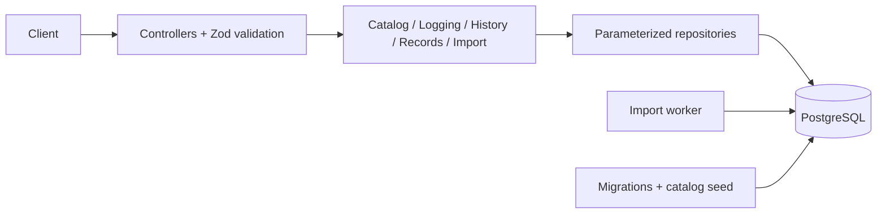

# Everfit Workout Logging API

A REST API for coaches to record client workouts: browse exercises, log workouts (single, bulk, or CSV upload), view filtered history, and compute personal records (PRs) with comparisons between two time periods.

**Stack:** NestJS 11, PostgreSQL 17 (direct `pg` queries, no ORM), Zod, Docker Compose, Node 24.

Related docs: [AI workflow](AI_WORKFLOW.md) · [Delivery evidence](docs/delivery-verification.md) · [Detailed design](docs/workout-api-design.md) · [Video walkthrough](artifacts/video/everfit-desktop/everfit-real-desktop-male.mp4)

## Architecture



- **Controllers** validate input, **services** own transactions and calculations, **repositories** contain only SQL.
- There is no ORM, external queue, cache, or authentication. The `userId` in the URL selects data; it does not prove identity.
- CSV imports use a durable job queue stored in PostgreSQL and **one separate worker**.

## Quick start

```bash
test -f .env || cp .env.example .env
# Edit .env: change POSTGRES_PASSWORD and the passwords in both DATABASE_URL values
# (use only letters, digits, "-" and "_")
```

### Option A: everything in Docker

```bash
docker compose up --build -d
curl http://localhost:3000/health     # {"status":"ok"}
```

Compose runs migrations, seeds the catalog, then starts the API and the import worker. Stop with `docker compose down` (data is kept; do **not** use `--volumes` if you want to keep the database). If port 3000 is busy: `PORT=3308 docker compose up --build -d`.

### Option B: API and worker on the host, PostgreSQL in Docker

Requires Node 24.21.0 and pnpm 12.9.1.

```bash
docker compose stop api import-worker
docker compose up postgres -d
pnpm install --frozen-lockfile
pnpm db:migrate && pnpm db:seed && pnpm build

pnpm start:dev            # terminal 1: API
pnpm start:import-worker  # terminal 2: CSV worker
```

> Run only **one** worker per database. Do not start a host worker while the Docker worker is running.

Swagger UI (only when `NODE_ENV=development`): http://localhost:3000/docs

## API

| Method | Route | Description |
| --- | --- | --- |
| GET | `/health` | Database connectivity check |
| GET | `/exercises` | Exercise list, `muscleGroup` filter, cursor pagination |
| POST | `/users/:userId/workout-entries` | Log one entry |
| POST | `/users/:userId/workout-entries/bulk` | Log many entries (atomic) |
| POST | `/users/:userId/workout-entries/bulk/csv` | Upload a CSV (returns 202, processed in the background) |
| GET | `/users/:userId/workout-entries/imports/:importId` | Import status |
| GET | `/users/:userId/workout-entries` | Filtered, paginated history |
| GET | `/users/:userId/personal-records` | PRs for one exercise |
| GET | `/users/:userId/personal-records/compare` | Compare PRs between two periods |

### Examples

Log one entry (`Idempotency-Key` is required):

```bash
curl -X POST http://localhost:3000/users/client-1/workout-entries \
  -H 'Content-Type: application/json' \
  -H 'Idempotency-Key: workout-1' \
  -d '{"date":"2026-10-09T08:00:00Z","exerciseName":"Bench Press","sets":[{"reps":5,"weight":135,"unit":"lb"}]}'
```

Bulk (all entries succeed or none are written):

```bash
curl -X POST http://localhost:3000/users/client-1/workout-entries/bulk \
  -H 'Content-Type: application/json' \
  -H 'Idempotency-Key: workout-bulk-1' \
  -d '{"entries":[{"date":"2026-10-01T08:00:00Z","exerciseName":"Bench Press","sets":[{"reps":8,"weight":60,"unit":"kg"}]},{"date":"2026-10-09T08:00:00Z","exerciseName":"Squat","sets":[{"reps":5,"weight":80,"unit":"kg"}]}]}'
```

History (filter by name, muscle group and date range, convert units):

```bash
curl --get http://localhost:3000/users/client-1/workout-entries \
  --data-urlencode 'exerciseName=bench' \
  --data-urlencode 'muscleGroup=chest' \
  --data-urlencode 'from=2026-10-01T00:00:00Z' \
  --data-urlencode 'to=2026-11-01T00:00:00Z' \
  --data-urlencode 'unit=lb' \
  --data-urlencode 'limit=20'
```

Personal records and comparison of two periods:

```bash
curl --get http://localhost:3000/users/client-1/personal-records \
  --data-urlencode 'exerciseName=Bench Press' --data-urlencode 'unit=kg'

curl --get http://localhost:3000/users/client-1/personal-records/compare \
  --data-urlencode 'exerciseName=Bench Press' \
  --data-urlencode 'baselineFrom=2026-09-01T00:00:00Z' --data-urlencode 'baselineTo=2026-10-01T00:00:00Z' \
  --data-urlencode 'comparisonFrom=2026-10-01T00:00:00Z' --data-urlencode 'comparisonTo=2026-11-01T00:00:00Z'
```

### Upload a 50,000-entry CSV

```bash
curl -X POST http://localhost:3000/users/athlete-1/workout-entries/bulk/csv \
  -H 'Idempotency-Key: workouts-csv-001' \
  -F 'file=@data/workouts-50000.csv;type=text/csv'

curl http://localhost:3000/users/athlete-1/workout-entries/imports/IMPORT_UUID
```

- The sample file [`data/workouts-50000.csv`](data/workouts-50000.csv) has 50,000 entries × 3 sets = 150,000 data rows.
- Header: `entryRef,date,exerciseName,setPosition,reps,weight,unit` (one row per set).
- Upload returns `202 queued`. Wait for `status=completed` before checking data. If a job stays `queued`, check the worker and its logs.
- An invalid file writes **no workouts**. If a failure happens midway, batches that already committed are kept.
- If upload or status returns 500 while `/health` is 200, migration `004` has usually not been applied (`pnpm db:migrate`).

Details: [CSV contract and recovery](docs/csv-import-design.md).

## Key design decisions

| Topic | Approach |
| --- | --- |
| **Atomic bulk** | One transaction per request; a failure in any entry rolls back everything |
| **Safe retries** | Per-user `Idempotency-Key`. Same key and payload replays the original response; same key with a different payload returns `409`; a new key creates new workouts |
| **Weight units** | Stores the original value and a normalized kg value (`numeric`, decimal.js, no floats). Responses use the unit the client requests |
| **Time** | All UTC; `from` is inclusive, `to` is exclusive |
| **Pagination** | Keyset cursor on `(date, id)`, default 20, maximum 100. Opt-in per route |
| **PRs** | Three independently selected metrics: heaviest set, highest volume (`weight × reps`), estimated 1RM (Epley). One SQL statement, no full-history load |
| **PR comparison** | Two arbitrary periods; result is `comparison - baseline` |
| **Exercises** | Catalog with stable IDs; names not in the catalog are rejected |

Full contract (cursors, rounding rules, tie-breaks, error codes) is in the [design doc](docs/workout-api-design.md).

### Data model

- `exercises`, `muscle_groups`, `exercise_muscle_groups`: catalog.
- `workout_entries`, `workout_sets`: workout data.
- `idempotency_requests`: retry keys and stored responses.
- `workout_imports`, `workout_import_batches`: CSV import jobs.

Key indexes: `workout_entries (user_id, performed_at DESC, id DESC)` for history, and `(user_id, exercise_id, performed_at DESC, id DESC)` for exercise filtering and PRs.

### Errors

All errors use this shape:

```json
{ "error": { "code": "VALIDATION_ERROR", "message": "...", "details": [] }, "requestId": "uuid" }
```

`400` invalid input · `404` unknown route · `409` idempotency conflict · `413/415` body too large or unsupported encoding · `503` database temporarily unavailable. Errors never echo input values or raw database errors.

## Testing

```bash
pnpm lint && pnpm build
pnpm test                                      # unit + integration (serial)
pnpm smoke --base-url http://localhost:3000    # requires a running API and worker
```

- Integration tests need `TEST_DATABASE_ADMIN_URL` (a local PostgreSQL with CREATEDB permission). Each run creates a random `everfit_test_<hex>` database and drops only the databases it created. **Never point it at a production server.**
- Tests verify real PostgreSQL contents (separate client, independent arithmetic): rollback, replay after restart, 10 concurrent clients across two API instances, and worker crash/resume.
- `pnpm smoke` calls all 9 routes, including replay, conflict, invalid CSV, pagination and unit conversion. It leaves data behind, so use it on a local environment only.

## Benchmarks with 50,000+ entries

All run on isolated databases, with results checked by an independent oracle:

| Command | What it checks |
| --- | --- |
| `pnpm test:performance --create-isolated --entries 50000 --sets-per-entry 3 --seed 42` | Reads: history and PRs over 50,000 entries / 150,000 sets |
| `pnpm test:performance:bulk` | CPU and memory during bulk writes, 51,000 entries |
| `pnpm test:performance:batch-retry --retain-database --output artifacts/performance/batch-retry-retained.json` | 500 batches × 100 entries, injected failure, rollback, retry, restart |
| `pnpm test:performance:csv --retain-database --output artifacts/performance/csv-import-retained.json` | Real CSV upload with one worker, injected SQL failure and retry |

Local results (concurrency 1):

- **Reads (p95):** history 3.9–7.8 ms · all-time PRs 130.6 ms · monthly PRs 30.0 ms · two-period comparison 68.5 ms.
- **JSON writes:** 50,000 entries / 150,000 sets in 22.4 s (500 batches).
- **CSV import:** 50,000 entries / 150,000 sets in 18.0 s, including one failure and retry. After a restart, replay kept all IDs and values unchanged.

These are local measurements, not production capacity claims. Methodology: [read](docs/read-performance.md) · [bulk](docs/bulk-performance.md) · [batch/retry](docs/batch-retry-benchmark.md) · [CSV](docs/csv-import-benchmark.md).

## Scaling to 10,000 coaches

- The API is stateless, so multiple replicas can share one PostgreSQL. The idempotency unique constraint coordinates retries across instances.
- The sum of all replicas' connection pools must stay within the database limit. Add a pooler (such as PgBouncer) once connection pressure is measured.
- Convert coach activity into requests/second, read/write mix and burst size, then load test against latency and error budgets before sizing infrastructure.
- Monitor latency, lock waits, database CPU/I/O, pool saturation and table growth.
- Tune indexes and queries first. Read replicas and caching need explicit rules for replication lag and invalidation.
- The idempotency table grows without bound. Define a retention policy once the allowed retry window is decided.
- Before using real client data, add authentication and per-tenant authorization.

## Configuration

| Variable | Default / constraint |
| --- | --- |
| `DATABASE_URL` | Required PostgreSQL URL |
| `PORT` | 3000 |
| `NODE_ENV` | `development` · `test` · `production` |
| `LOG_LEVEL` | `info` |
| `DB_POOL_MAX` | 10 |
| `DB_STATEMENT_TIMEOUT_MS` | 5000 |
| `DB_LOCK_TIMEOUT_MS` | 3000 |
| `TEST_DATABASE_ADMIN_URL` | Tests only, requires CREATEDB permission |

Invalid configuration stops the app before it listens and reports only field names, never values.
