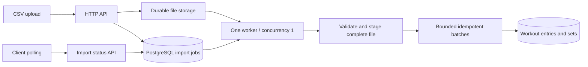

# CSV import with one worker — proposal

Status: design and acceptance cases only; no upload endpoint, queue, CSV parser,
or import worker is implemented. The assignment requires efficient endpoints over
50,000+ workout entries per user. Existing JSON bulk logging accepts 100 entries
and 1,000 sets per atomic request; 50,000 entries fit into 500 requests at three
sets per entry. CSV is an additional ingestion option.

## Suggested scope

Use one separate Node/Nest worker process, concurrency 1, with durable import jobs
in the existing PostgreSQL database. Keep HTTP API and worker lifecycles separate.
No Redis is necessary for this initial design; reassess if queue requirements grow.
One worker bounds import concurrency but does not establish import throughput or
protect reads from database I/O contention. Measure those together before sizing.



Proposed routes:

- `POST /users/:userId/workout-imports`: multipart `file` plus `Idempotency-Key`;
  respond 202 with import ID/status URL after durable upload and job creation.
- `GET /users/:userId/workout-imports/:importId`: queued/validating/running/
  completed/failed, parsed rows, validated entries, committed entries/sets,
  retry attempt, and bounded errors with record/column positions.

These routes do not exist yet. A 202 acknowledges queued work, not committed
workouts. Scope job lookup by route user; authentication remains outside the
assignment. Any future production deployment needs authenticated ownership.

## File contract

Use one logical CSV record per set, with header:

```csv
entryRef,date,exerciseName,setPosition,reps,weight,unit
w1,2026-01-01T08:00:00.000Z,Bench Press,1,8,135,lb
w1,2026-01-01T08:00:00.000Z,Bench Press,2,6,60,kg
w2,2026-01-02T08:00:00.000Z,Squat,1,5,80,kg
```

Thus 50,000 workouts × 3 sets means 150,000 CSV records, excluding the header.
Require contiguous records per `entryRef`, identical date/exercise within an
entry, unique sequential positions starting at 1, and at most 100 sets/entry.
Different `entryRef` values can intentionally represent identical workouts.
Reject a reference appearing again after its group closes. Route user owns the
entire file; no per-row user override. Parse UTF-8/BOM, LF/CRLF, quoted commas,
escaped quotes, and quoted newlines with a maintained CSV parser, not `split(',')`.
Convert numeric text explicitly, then apply the existing strict workout schemas.

Initial proposed limits: one file, 32 MiB, 50,000 entries, 150,000 sets, 64 KiB
per logical record; make these explicit configuration and test the exact limits.
Byte, row and entry limits are independent. Reject unsupported headers, malformed
CSV, invalid UTF-8/NUL, unknown exercises, non-UTC timestamps, and invalid numbers.

## Durability and retries

1. Reserve an upload row with a generated file key and ownership lease before
   streaming to a persistent shared volume (single host) or object storage
   (multiple hosts). Finish and hash the immutable file before exposing the queued
   job. Never trust an uploaded filename as a path.
   Bound multipart fields/parts/bytes separately from the existing JSON body cap.
2. Enforce unique `(user_id, idempotency_key)` with a file digest: same key/digest
   returns the same job; changed digest conflicts. Job attachment locks the upload
   row and atomically changes `ready` to `attached` with job creation. Cleanup
   claims only expired, unattached upload rows by changing their state to
   `deleting` under the same row lock before deleting the file; attachment refuses
   that state. An uploader that lost its lease cannot create a job or return 202.
   Retry failed deletions; retain attached files for retry. This prevents cleanup
   racing a delayed job-creation transaction; an age threshold alone is inadequate.
3. Claim a queued job in a short transaction; persist attempt/lease ownership.
   A lease heartbeat and attempt token allow restart recovery and prevent stale
   attempts from overwriting newer job status. A queue claim can use
   `FOR UPDATE SKIP LOCKED`; PostgreSQL documents its queue use and warns against
   treating it as a consistent general read. [PostgreSQL SELECT](https://www.postgresql.org/docs/17/sql-select.html)
4. Parse and validate into persistent staging rows keyed by job/entry ordinal.
   Mark validation complete only after EOF and all checks succeed. Invalid final
   records leave zero workout writes. Persist immutable validated batches so
   retries preserve their content and boundaries. Persist resolved exercise IDs,
   not just names, during validation. Each write transaction must verify that the
   name still resolves to its staged ID under catalog row locks held through the
   insert; fail explicitly on a rename/reassignment. The current logging service
   does not accept an expected-ID map: implementation must add this internal
   check before reusing it, or use an internal ID-based write operation with the
   same validation/transaction/idempotency guarantees. A separate preflight
   lookup is insufficient because the mapping can change before the insert.
5. Write sequential batches of at most 100 entries AND 1,000 sets without splitting
   an entry. Reuse the logging service with a stable key per job/batch, then save
   the checkpoint. A crash after commit but before checkpoint replays that same
   key; it must not duplicate entries. The existing logging service owns its
   transaction, so checkpoint updates are a separate transaction and must tolerate
   this gap. Reserve import-generated keys from manual requests in the future
   implementation, or introduce a separate internal idempotency namespace.
6. Retry transient failures with bounded backoff; use the same keys for uncertain
   commit outcomes. Stop stale attempts between batches. Mark completion only
   after all batches are committed and counters agree. Persist committed progress
   on failure; retry resumes it. Never claim file-wide rollback: successful batches
   are visible through history while the import runs. File-wide atomic visibility
   would require a different publish/staging design.
7. Graceful worker shutdown finishes the active batch and releases ownership;
   SIGKILL recovery relies on the lease. Keep source/staging data until terminal
   retention expires; clean them on success, failure and abandoned uploads.

Await each batch before reading more work. Node's stream pipeline provides
backpressure/error handling; it does not replace application-level batch limits.
[Node 24 streams](https://nodejs.org/download/release/v24.21.0/docs/api/stream.html)
Nest's Express adapter supports file interceptors with storage/limit options;
check the installed Nest 11 API when implementing because the current docs also
describe newer framework features. [Nest file upload](https://docs.nestjs.com/techniques/file-upload)

## Acceptance cases before shipping

Run against isolated PostgreSQL, real HTTP multipart upload and a real child
worker process. Keep expensive 50,000-entry cases outside routine integration.

| Case | Required assertions |
| --- | --- |
| Worker initially stopped | Upload returns 202; durable queued job; zero workout rows. |
| Start exactly one worker | 50,000 entries/150,000 sets committed, correct owners/exercises/dates/order/originals/exact kg; every row checked with independent arithmetic. |
| Two queued files | One active job at a time; each completes without mixing users or checkpoints. |
| Invalid first/middle/final record | Failed validation with bounded safe errors; zero workouts for that job; staging cleaned according to retention. |
| CSV syntax/encoding | BOM, LF/CRLF, quotes/commas/newlines work; wrong headers, unclosed quote, NUL, invalid UTF-8 and repeated noncontiguous entryRef fail. |
| Boundaries | Empty/header-only file, exact/max+1 bytes/rows/entries/sets/record length; chunk size respects both entry and set caps. |
| Duplicate upload | Same user/key/file yields one job; changed file gives conflict; distinct keys allow intentional repeats. |
| Crash before batch commit | Partial batch rolled back; restart resumes; no lost or extra sets. |
| Crash after commit, before checkpoint | Same batch replays; exact original IDs and values remain; counters not incremented twice. |
| Database outage/timeout | Durable retryable state and known committed progress; no false completed status or swallowed error. |
| API/worker restart and lease expiry | Job/file survive; stale ownership cannot regress status; no duplicate writes. |
| Reads during import | History/PR remain responsive with documented partial visibility; measure p95 while importing; sample worker/API RSS separately. |
| Upload abort / process crash | Partial file never queued; orphan cleanup bounded and does not delete active/retryable jobs. |
| Cleanup races job attachment | Pause job creation after upload; run sweeper concurrently. Exactly one state transition wins: either valid attached file + 202, or cleanup + rejected attachment; never 202 pointing to a deleted file. |
| Catalog changes during import | Rename/reassign an exercise name between or during batches. A batch uses its validated ID or fails explicitly; never silently switches to a different exercise ID. |

Report upload acceptance latency, total import time, entries/s, read p95, worker
peak RSS, DB waits and retries. Establish budgets before running; existing bulk
benchmark results are not measurements of this unimplemented CSV workflow.
