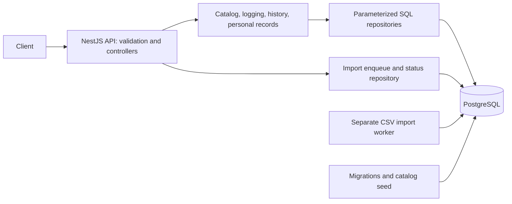
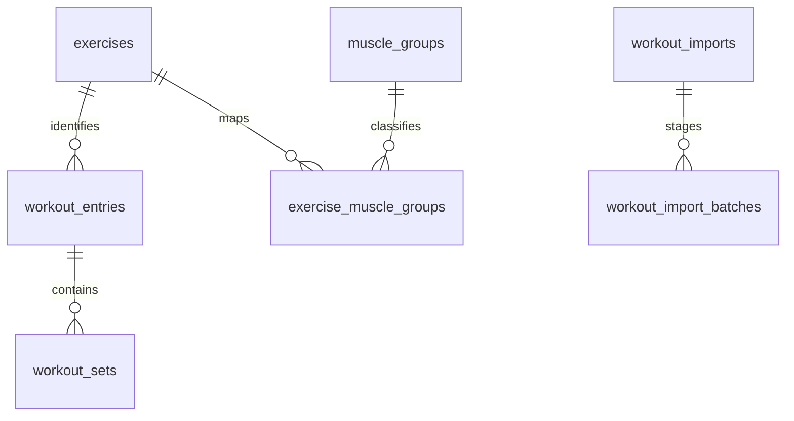

# Everfit Workout Logging API — Technical Design

## 1. Purpose and scope

This document describes the implemented system: exercise discovery, single and bulk workout logging, asynchronous CSV imports, filtered history, and personal records with period comparisons. It consolidates the architecture and its trade-offs; [workout contracts](workout-api-design.md) and [CSV import details](csv-import-design.md) provide deeper reference material.

The principal requirements are correct mixed-unit calculations, atomic JSON writes, safe retries, deterministic reads, and processing histories containing at least 50,000 entries per user. Authentication, user management, workout editing/deletion, and an exercise-management API are outside the assignment scope. A route's `userId` selects data but does not establish identity or permission.

## 2. Architecture and technology decisions

| Component             | Selection and rationale                                                                                                               |
| --------------------- | ------------------------------------------------------------------------------------------------------------------------------------- |
| Runtime               | Node.js 24, TypeScript strict mode, pnpm; exact dependency versions are recorded in [package.json](../package.json) and the lockfile. |
| HTTP application      | NestJS 11 with Express; feature modules and dependency injection separate transport, business rules, and persistence.                 |
| Database              | PostgreSQL 17; relational constraints, transactions, unique keys, and SQL aggregation match the consistency requirements.             |
| Data access           | Direct `pg` queries without an ORM; transaction boundaries and record-ranking queries remain explicit.                                |
| Validation            | Zod and `nestjs-zod`; shared schemas validate API contracts and startup configuration.                                                |
| Decimal arithmetic    | PostgreSQL `numeric` plus `decimal.js`; preserve exact normalized weights and avoid binary floating-point calculations.               |
| Background processing | PostgreSQL job/staging tables and one separate worker; durable recovery without an external queue or shared filesystem.               |
| Operations            | Docker Compose, `node-pg-migrate`, structured Pino logging, development-only Swagger.                                                 |

Catalog, logging, history, and personal-record controllers delegate to services; repositories own their SQL. Logging services own business transaction boundaries through `DatabaseService.withTransaction`. The CSV controller delegates enqueue/status directly to its repository; the worker owns staging and batch transactions. Shared schemas, units, database access, and HTTP error handling live outside feature modules. See [application modules](../src/modules) and [database service](../src/database/database.service.ts).

## 3. Data model

| Table                    | Responsibility and important constraints                                                                                                            |
| ------------------------ | --------------------------------------------------------------------------------------------------------------------------------------------------- |
| `exercises`              | UUID identity, display name, unique normalized name. Application normalization trims and lowercases names; it does not invent aliases.              |
| `muscle_groups`          | UUID identity and unique normalized group name.                                                                                                     |
| `exercise_muscle_groups` | Many-to-many catalog relationship with foreign keys and a composite primary key.                                                                    |
| `workout_entries`        | UUID identity, opaque `user_id`, exercise foreign key, `performed_at` and `created_at` timestamps.                                                  |
| `workout_sets`           | Entry foreign key, ordered position, reps, original weight/unit, canonical kg weight; unique `(entry_id, position)`.                                |
| `idempotency_requests`   | Primary key `(user_id, key)`, request fingerprint, successful response status/body, creation time.                                                  |
| `workout_imports`        | Job identity, unique `(user_id, idempotency_key)`, exact-file hash, queued source bytes, status, progress, attempts, and sanitized failure details. |
| `workout_import_batches` | Staged JSON payloads, keyed by `(import_id, position)` and linked to the import job.                                                                |

There is no users table. `userId` is a case-sensitive string of 1–128 ASCII letters, digits, underscores, or hyphens. Identical user/exercise/timestamp combinations may represent separate workouts; retry keys, rather than these values, prevent accidental duplicate submissions. Catalog foreign keys protect historical references. Names and muscle groups are read from the current catalog rather than copied into each workout.

Original weights use `numeric(13,6)` and normalized weights use `numeric(24,14)`. Workout timestamps use `timestamptz(3)` and database sessions use UTC. Set position, reps, numeric bounds, and relationships have database constraints in addition to application validation. Supported units are enforced by the application registry. [Migrations](../migrations) define the authoritative schema, including the later catalog normalization and cursor-index changes.

| Index or constraint                                           | Access pattern                                   |
| ------------------------------------------------------------- | ------------------------------------------------ |
| Entries `(user_id, performed_at DESC, id DESC)`               | User history and date-ordered keyset pagination. |
| Entries `(user_id, exercise_id, performed_at DESC, id DESC)`  | Exercise-specific history and record candidates. |
| Sets unique `(entry_id, position)`                            | Fetch ordered sets for selected entries.         |
| Mapping `(muscle_group_id, exercise_id)`                      | Resolve exercises for a muscle group.            |
| Exercises `(normalized_name COLLATE "C", id)`                 | Stable catalog ordering and cursor traversal.    |
| Pending imports `(next_attempt_at, created_at)` partial index | Limit queue scans to queued/running jobs.        |

## 4. API boundaries

All workout routes below are relative to `/users/:userId`. Successful JSON creation returns `201`; CSV submission returns `202`; reads return `200`.

| Method | Route                                | Contract                                                                                     |
| ------ | ------------------------------------ | -------------------------------------------------------------------------------------------- |
| GET    | `/health` (root)                     | Database connectivity check; unavailable database returns `503`.                             |
| GET    | `/exercises` (root)                  | Catalog pagination with optional exact muscle-group filter.                                  |
| POST   | `/workout-entries`                   | One workout with a required `Idempotency-Key`.                                               |
| POST   | `/workout-entries/bulk`              | Atomic JSON batch with a required `Idempotency-Key`.                                         |
| POST   | `/workout-entries/bulk/csv`          | Multipart `file` and required `Idempotency-Key`; persist and queue an import.                |
| GET    | `/workout-entries/imports/:importId` | User-scoped job status, progress, and failure details.                                       |
| GET    | `/workout-entries`                   | History filtered by exercise substring, muscle group, date range, and requested weight unit. |
| GET    | `/personal-records`                  | Three independently selected records for an exact catalog exercise and optional date range.  |
| GET    | `/personal-records/compare`          | Records and differences for two explicit periods; overlapping periods are allowed.           |

Single writes accept `{date, exerciseName, sets: [{reps, weight, unit}]}`; bulk writes wrap entries in `{entries: [...]}`. Exercise lookup trims and lowercases the name and rejects unknown names. Strict schemas reject unknown object fields, invalid values, and unsupported units. Body numbers are not coerced from strings.

| Input           | Enforced limit                                                              |
| --------------- | --------------------------------------------------------------------------- |
| JSON body       | 1 MiB.                                                                      |
| JSON bulk       | 1–100 entries and at most 1,000 sets in total.                              |
| Workout         | 1–100 sets; integer reps from 1 to 10,000 per set.                          |
| Weight          | 0–1,000,000 inclusive, at most six fractional digits; `kg` or `lb`.         |
| Timestamps      | Valid UTC `Z` timestamps with seconds and at most millisecond precision.    |
| Time ranges     | Inclusive `from`, exclusive `to`; start precedes end when both are present. |
| Pagination      | Default 20, maximum 100; cursor length at most 4,096 characters.            |
| Idempotency key | 1–128 printable, non-whitespace ASCII characters.                           |
| CSV upload      | One file, 32 MiB, at most 50,000 entries and 150,000 sets.                  |

Errors use `{error: {code, message, details}, requestId}`. Validation returns `400`, missing resources/routes `404`, retry conflicts `409`, oversized bodies `413`, unsupported body encoding `415`, transient database failures `503`, and unexpected failures `500`. Responses do not expose raw SQL errors, stack traces, credentials, or rejected input values. See [schemas](../src/schemas) and [exception filter](../src/common/http-exception.filter.ts).

## 5. Atomic JSON logging and safe retries

1. Validate the route, header, and body. Hash a canonical representation containing the operation, user, and validated payload. Object-key order is normalized; array order and string values are preserved.
2. Begin a `READ COMMITTED` transaction on one checked-out database connection. Reserve `(user_id, key)` with `INSERT ... ON CONFLICT DO NOTHING`.
3. If the reservation already exists, read it in a separate statement. A matching fingerprint returns the stored response; a different fingerprint returns `409`. Replay occurs before resolving current catalog metadata.
4. For a new reservation, resolve all exercises, insert entries and sets, construct the response, and store its `201` status and body in the reservation.
5. Commit before returning success. Any failure rolls back both workout data and the new reservation; release or discard the connection as appropriate.

The unique key coordinates concurrent requests across API processes. Single and bulk JSON routes share a user's key namespace, and the operation is part of the fingerprint. A different key intentionally creates new workouts. Successful replay preserves response content and IDs, including after restart. Validation failures and rolled-back writes do not consume a new key.

If the connection fails around commit, the client retries the same key to discover the committed outcome safely. Synchronous logging does not automatically retry writes. Database statement and lock timeouts bound individual SQL operations; retryable HTTP failures require the client to reuse its key. Implementation: [logging service](../src/modules/workouts/workout-logging.service.ts), [idempotency repository](../src/modules/workouts/idempotency.repository.ts), and [fingerprinting](../src/modules/workouts/request-fingerprint.ts).

## 6. CSV import lifecycle and recovery

CSV uses the ordered header `entryRef,date,exerciseName,setPosition,reps,weight,unit`, with one logical record per set. Contiguous rows sharing an `entryRef` form a workout; their date/exercise must match and positions must run from 1 without gaps. References are local to the file. Parser rules and numeric text validation are detailed in the [CSV contract](csv-import-design.md).

| Stage              | Transaction and visibility                                                                                                                                                                                             |
| ------------------ | ---------------------------------------------------------------------------------------------------------------------------------------------------------------------------------------------------------------------- |
| Enqueue            | Store exact source bytes and SHA-256 hash with the job, then return `202`. This acknowledges durable acceptance.                                                                                                       |
| Validate and stage | Validate the entire file and catalog references in one transaction; stage batches with pinned exercise IDs. Invalid files write zero workouts. Successful staging clears the source and changes `queued` to `running`. |
| Apply              | Write at most 100 entries and 1,000 sets per transaction. Workout insertion, staged-batch deletion, and progress updates commit together. Catalog locks and ID checks detect remapping.                                |
| Complete           | The final batch marks the job `completed`; progress counters describe all committed entries and sets.                                                                                                                  |
| Fail               | Mark the job `failed`, sanitize the error, and remove remaining source/staging data. Previously committed workout batches remain visible.                                                                              |

One worker holds a PostgreSQL session advisory lock on a dedicated connection; a second worker for that database exits. A crash rolls back the active transaction, and a replacement process resumes remaining batches. Attempts are persisted before each step. Serialization failures, deadlocks, lock timeouts, and statement timeouts allow up to three attempts per step with 100/200 ms retry delays. Successful steps reset attempts. Broken connections terminate the worker; process restart is required to resume.

CSV keys have a separate namespace from JSON keys. The same user/key and exact file bytes return the existing job at its current status; changed bytes return `409`. A terminal failed job is not restarted by replay. Fixing a validation failure requires a new key. After partial writes, reconcile committed data before re-uploading under a new key to avoid duplicates.

Uploads are buffered in API memory. Parsing is incremental, but the worker retains the source buffer during validation. Concurrent uploads multiply memory usage, and queued sources/staged payloads add database storage and WAL costs. Full-file staging is one potentially long transaction even though each write batch is bounded. See [worker implementation](../src/modules/imports/import-worker.service.ts).

## 7. History, pagination, and consistency

History sorts by `(performed_at DESC, id DESC)`. SQL applies user, date, exercise substring, muscle-group, and cursor predicates before selecting `limit + 1` entries. It then fetches sets only for the returned page, avoiding pagination over joined set rows. Muscle-group filters use `EXISTS` to avoid duplicates; exercise search escapes SQL wildcard characters so matching remains a literal substring.

History cursors bind the last timestamp/ID to the user and normalized filters, including output unit. Catalog cursors use `(normalized_name COLLATE "C", id)` ascending and bind the muscle-group filter. Both validate their structure and resource context; page size may change between requests. Cursors are positioning data, not authorization tokens.

Pagination is not a snapshot. Backdated inserts can appear on later history pages; newer entries require a fresh first page. Catalog renames can move items across its boundary. History reads entries and sets in separate statements; the append-only workout contract makes this practical, but mutable workout support would require revisiting consistency. Empty history returns an empty page and an explanatory message. Implementation: [history repository](../src/modules/workouts/workout-history.repository.ts).

## 8. Weight precision and personal records

The central unit registry defines `1 lb = 0.45359237 kg`. Input is preserved in its original unit and normalized to kg with fourteen fractional digits. PostgreSQL numeric values remain strings in application code; decimal calculations use 50 significant digits and round half up. Response weights use four fractional digits, while original weights use six. JSON write responses use kg; history and records use the requested unit, defaulting to kg.

| Record                    | Ranking and value                                                  |
| ------------------------- | ------------------------------------------------------------------ |
| Heaviest set              | Maximum canonical weight.                                          |
| Highest-volume set        | Maximum `weight_kg × reps`, expressed as `kg*reps` or `lb*reps`.   |
| Estimated one-rep maximum | Epley: `weight_kg × (1 + reps / 30)`; no special case for one rep. |

Each metric selects its own winner. Ties resolve by earliest workout timestamp, then entry ID, then set position. Epley ranking uses the exact numerator `weight_kg × (30 + reps)` before dividing the winning value by 30. One SQL statement evaluates all metrics and requested periods from one database snapshot, returning winners without loading the user's full history into application memory.

Comparisons calculate `comparison - baseline` before display rounding; Epley differences subtract exact numerators before division. Empty periods return null records, and differences are null when either period lacks a winner. Responses include the achieved timestamp and source entry/set. See [record query](../src/modules/personal-records/personal-records.repository.ts) and [decimal calculations](../src/modules/personal-records/record-calculations.ts).

## 9. Runtime, observability, and security boundaries

Compose starts PostgreSQL, runs migrations and the catalog seed, then starts the API and worker. A named volume persists database contents. Configuration is validated before opening the HTTP listener. API pools default to 10 connections; the Compose worker uses a pool maximum of 2 and holds a dedicated session. Default statement/lock timeouts are 5,000/3,000 ms. Shutdown hooks close application resources.

The API assigns request IDs and emits structured logs with restricted serializers and redaction. Swagger is enabled only in development. `/health` checks database connectivity; it does not prove migrations are current or that the CSV worker is progressing. Operators must also inspect worker status, queued-job age, progress counters, and logs. No automatic worker restart policy is configured.

Parameterized SQL, strict validation, upload limits, sanitized errors, and user-scoped queries are implemented. Authentication, tenant authorization, rate limiting, and automatic expiry of idempotency/job metadata are not implemented. These are explicit production-readiness gaps; accepting `userId` alone allows callers to select another user's data.

## 10. Verification and scaling trade-offs

Unit tests cover validation, conversion, rounding, cursor/fingerprint behavior, record arithmetic, and CSV parsing. Real PostgreSQL integration tests cover rollback, replay/conflicts, filters, independent record winners, concurrent requests across API instances, worker restart, and batch recovery. Persistence checks use separate clients and independent arithmetic. Tests create isolated databases; smoke tests require a running API/worker and leave their fixtures behind.

Use `pnpm lint`, `pnpm build`, and `pnpm test` for the normal verification suite. Performance commands separately exercise reads, JSON batches, and actual CSV uploads over 50,000+ entries. Existing measurements, dataset definitions, and limitations are recorded in [read performance](read-performance.md), [bulk performance](bulk-performance.md), [batch/retry evidence](batch-retry-benchmark.md), [CSV benchmark](csv-import-benchmark.md), and [delivery verification](delivery-verification.md). These reports are historical local evidence, not production capacity guarantees or fresh test results from this document change.

The stateless API can run multiple replicas against one database; their total connection pools must fit database capacity. Serving 10,000 coaches requires measuring activity rate, read/write mix, bursts, latency, and errors rather than equating user count with throughput. Tune query plans and indexes from measurements before adding caching, replicas, or precomputed records. Arbitrary-period records still require range-sensitive evaluation, which is why this implementation calculates them on demand.

The worker is intentionally single-process per database. Additional worker concurrency would require a different claim/lease protocol and concurrency testing. Production operation also needs defined retry/metadata retention windows, upload admission limits, worker supervision, authenticated tenant boundaries, and monitoring. Read replicas or caches would need explicit freshness guarantees for history, import progress, and retry behavior. These are future decisions, not implemented infrastructure.
