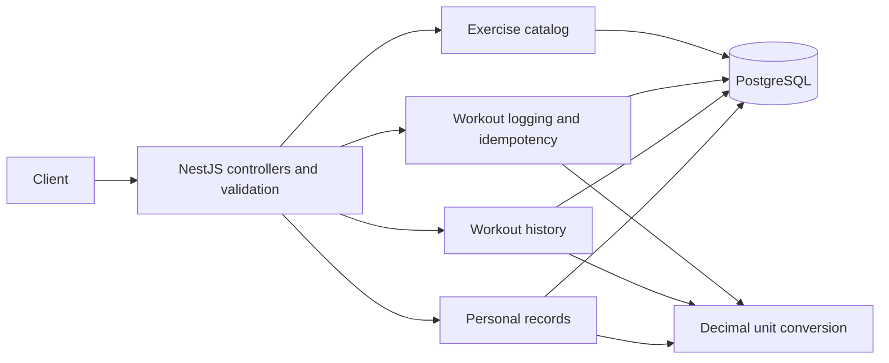

# Workout Logging API Design

Status: Phase 04 execution authorized on 2026-10-09. Foundation, unit conversion, workout schemas, catalog, atomic logging, and filtered history implemented; verification recorded in README and phase plans. Personal-record endpoints remain planned.

## Intent and scope

Build the API in [the assignment](../Backend%20Engineer.pdf) so coaches can log client exercises, inspect history, and compare personal records. Deliver correct mixed-unit calculations, atomic writes, retry protection, and measured behavior with at least 50,000 entries per user.

Confirmed stack: NestJS, PostgreSQL, Docker Compose. No authentication. Accept `userId` at the API boundary; it selects data but does not establish identity or authorization. No user CRUD, exercise-management API, editing/deleting workouts, queues, cache, frontend, or precomputed PR tables in this assignment.

## Decisions made with the user

| Topic | Agreed decision |
| --- | --- |
| Bulk logging | Entire request succeeds or rolls back |
| Retries | Required `Idempotency-Key` on single and bulk logging |
| Time | UTC input/output and storage; inclusive start, exclusive end |
| Exercises | Database catalog, case-insensitive exact lookup when logging, unknown names rejected |
| Metadata | Seeded, configurable muscle groups; exercises may have multiple groups |
| Comparisons | Two arbitrary, explicit UTC ranges |
| Persistence | Relational entries and sets; PRs calculated on demand |
| History | Cursor pagination; newest workout first, ID tie-breaker |
| PR ties | Earliest workout timestamp, then entry ID, then set position |
| Idempotency retention | No automatic expiry for this assignment |

Rejected storage alternatives: JSONB sets complicate relational constraints and set-level aggregation; precomputed PRs add write complexity without eliminating arbitrary-range queries. PostgreSQL fits the chosen relationships, transactions, uniqueness constraints, and analytical queries. This is a design rationale, not a benchmark result.

## Architecture and proposed implementation defaults

Use a modular NestJS application, constructor injection, and feature-local controllers, services, and repositories. Controllers validate and delegate; services own business decisions; repositories own parameterized SQL. Cross-feature interfaces are explicit, with no circular imports. The exercise module exports `ExercisesService`; controllers and other features do not inject its repository. The service owns name normalization, public response mapping, and transient database error translation; the repository accepts normalized names and executes SQL on the supplied transaction client. Catalog responses are runtime-validated through `ZodResponse` and `ZodSerializerInterceptor`.

Proposed tooling for document review: TypeScript strict mode, pnpm, `pg` for direct SQL, `node-pg-migrate` for migrations, Zod with `nestjs-zod` for API/config validation, `decimal.js` for decimal conversion, `nestjs-pino` for JSON logs, Jest and Supertest for tests. Direct SQL makes the required aggregation and transaction behavior visible without adding an ORM. Phase 01 pinned and verified compatible versions; see README and package.json. Phase 02 adds decimal.js 10.6.0 and development-only Swagger 11.4.7.

Features live under `src/modules/exercises/`, `src/modules/workouts/`, and `src/modules/personal-records/`. Logging and history have separate services/repositories within workouts. Shared concerns live in `src/database/`, `src/config/`, `src/common/`, `src/units/`, and `src/schemas/`. Keep code files below 200 lines.

## Relational model

IDs are UUIDs generated by the application. There is no users table. `user_id` is an opaque, case-sensitive string, 1–128 characters from letters, digits, underscore, and hyphen. The following precise lengths and limits are proposed defaults added while documenting the design.

| Table | Fields and constraints |
| --- | --- |
| `exercises` | `id`, `name` (1–200 chars), `normalized_name` unique; normalize with JavaScript trimming/lowercasing (application authority, normalized storage is text for Unicode expansion); do not collapse internal whitespace or invent aliases |
| `muscle_groups` | `id`, unique lowercase `name` (1–80 chars) |
| `exercise_muscle_groups` | Exercise/group foreign keys; composite primary key |
| `workout_entries` | `id`, `user_id`, `exercise_id` FK, `performed_at timestamptz(3)`, `created_at timestamptz(3)` |
| `workout_sets` | `id`, `entry_id` FK, `position`, `reps`, `original_weight numeric(13,6)`, `original_unit`, `weight_kg numeric(24,14)`; unique `(entry_id, position)` |
| `idempotency_requests` | `user_id`, `key`, `fingerprint`, nullable `response_status`/`response_body jsonb` while inside transaction, `created_at`; primary key `(user_id, key)` |

Set positions start at 1. Reps are integers from 1–10,000. Original weight is finite, 0–1,000,000 inclusive, at most six decimal places. Database checks enforce numeric bounds, positive positions, and reps bounds; the unit registry validates supported units at the application boundary. No uniqueness constraint on user/exercise/time. Never cascade-delete historical entries when catalog metadata changes.

Initial indexes: entries `(user_id, performed_at DESC, id DESC)` and `(user_id, exercise_id, performed_at DESC, id DESC)`; sets `(entry_id, position)` from its unique constraint; mapping reverse index `(muscle_group_id, exercise_id)` in addition to its primary key. PRs filter entries before joining sets. Use `EXISTS` for muscle-group filtering to avoid duplicate entries. Match literal exercise substrings; escape `%`, `_`, and the SQL escape character in LIKE patterns. Evaluate trigram indexing only if catalog-search plans justify it; it is not required initially. PostgreSQL documents unique-index enforcement and optional trigram search support in its [unique index](https://www.postgresql.org/docs/current/indexes-unique.html) and [pg_trgm](https://www.postgresql.org/docs/current/pgtrgm.html) documentation.

## Units and numerical behavior

Use a single registry with decimal factors to kg: `kg = 1`, `lb = 0.45359237`. Adding a unit changes this registry and its tests, not service conditionals. Do not add `stone` to the public contract in the initial release.

With six decimal places of input and eight in the lb factor, fourteen normalized decimal places preserve multiplication exactly. Keep database NUMERIC values as decimal strings in application code; do not register a driver parser that silently converts them to JavaScript numbers. PostgreSQL describes NUMERIC exact arithmetic and scale coercion in its [numeric-type documentation](https://www.postgresql.org/docs/current/datatype-numeric.html).

Perform arithmetic with decimal strings and 50 significant digits in the application. Return calculated/output weights as decimal strings with four fractional digits, using round-half-up. Original weights return six fractional digits and their original unit. These output details are proposed defaults, avoiding silent binary-float changes at the API boundary. Calculate comparison differences before display rounding.

Heaviest set ranks by `weight_kg`. Volume ranks by `reps * weight_kg`. Epley ranks by the exact numerator `weight_kg * (30 + reps)` and divides the winning value by 30 for output; this avoids recurring division affecting rank/tie decisions. Do not special-case a one-rep set. Volume has units `kg*reps` or `lb*reps`; heaviest/estimated 1RM have units `kg` or `lb`. All three records can come from different sets.

## HTTP contracts

| Method | Route | Behavior |
| --- | --- | --- |
| GET | `/exercises` | Read-only discovery; cursor-paginated catalog with muscle-group names |
| POST | `/users/:userId/workout-entries` | One exercise entry; required idempotency header |
| POST | `/users/:userId/workout-entries/bulk` | Atomic array of entries; required idempotency header |
| GET | `/users/:userId/workout-entries` | Filtered, paginated history |
| GET | `/users/:userId/personal-records` | Exact exercise name; optional time range |
| GET | `/users/:userId/personal-records/compare` | Two explicit time ranges |
| GET | `/health` | Operational readiness: 200 if DB reachable, otherwise structured 503 |

Register static `/compare` and `/bulk` routes explicitly. Logging accepts `{date, exerciseName, sets: [{reps, weight, unit}]}`; bulk accepts `{entries: [...]}`. `weight` is a JSON number; numeric strings are rejected. Do not accept `userId` in the body. Single creation returns `{data: WorkoutEntry}`; bulk returns `{data: WorkoutEntry[]}` in request order; both return 201.

`WorkoutEntry` contains `id`, `userId`, `date`, `createdAt`, `exercise: {id, name, muscleGroups}`, and ordered `sets`. Each set contains `id`, `position`, `reps`, `weight`, `unit`, `originalWeight`, and `originalUnit`. Creation responds in kg; history responds in its requested unit. `weight` is the four-decimal output string; `originalWeight` preserves the six-decimal original value. Raw `weightKg` remains internal.

History accepts only `exerciseName`, `muscleGroup`, `from`, `to`, `unit`, `limit`, and `cursor`. Exercise search is a case-insensitive literal substring; muscle group is a case-insensitive exact name. Unknown filter names produce an empty history, not a validation error. Default `unit=kg`, `limit=20`; maximum limit 100. Reject duplicate query parameters. Explicitly parse query integers; do not coerce body numeric values.

History returns `{data: WorkoutEntry[], pagination: {nextCursor, hasMore}, message}`. `message` is `null` for nonempty results, otherwise `No workout entries found for the requested filters.` Fetch `limit + 1` entries in the database, then retrieve only their sets; do not paginate joined set rows. The cursor is base64url JSON containing a format version, last date/ID, and a digest binding it to user and normalized filters (including unit and excluding page size). Validate decoded structure/size/binding; a cursor is not an authorization token. Ordering is `(performed_at DESC, id DESC)` with a strict tuple predicate after the last item. Append-only keyset traversal prevents already-returned rows from repeating, but is not a snapshot: concurrent backdated entries may appear later, and newer ones require a fresh first page.

PR queries require catalog `exerciseName`; unknown names return 400. Standard queries accept `from`, `to`, `unit`; omitted bounds are open-ended. Comparison queries accept `baselineFrom`, `baselineTo`, `comparisonFrom`, `comparisonTo`, `unit`, with all four bounds required. Overlapping ranges are allowed and evaluated independently in one database statement/snapshot. Dates use valid UTC `Z` timestamps, up to millisecond precision; reject date-only, local timestamps, nonzero offsets, and invalid calendar dates. Require `from < to` where both bounds exist. Missing bounds on history/standard PRs are open-ended.

`PersonalRecords` contains `heaviestSet`, `highestVolumeSet`, and `estimatedOneRepMax`. Each is `null` or `{value, unit, achievedAt, entryId, setPosition, reps, weight, weightUnit}`; `weight` is the originating set's weight in the requested unit. Standard response is `{data: PersonalRecords, message}`. Empty PRs return all three fields null and `No workout entries found for the requested exercise and range.` Comparison response is `{data: {baseline: {range, records, message}, comparison: {range, records, message}, differences}}`. Differences contain the same three metric names, each `null` or `{value, unit}`, with value = comparison minus baseline. No percentage comparison or fabricated zero record.

Validate strict object shapes; reject unknown fields, unsupported units, nulls, nonfinite numbers, empty sets, and malformed ranges. Proposed limits: 100 entries per bulk request, 100 sets per entry, 1,000 sets total per request, 1 MiB JSON body, idempotency keys 1–128 printable non-whitespace ASCII characters, and cursor encoded length at most 4,096. Pagination is opt-in per route: routes without filters use `@Query() query: CursorPaginationQueryDto`; exercises uses `ExerciseListQueryDto`, whose schema extends the shared Zod contract in `src/schemas/pagination.schema.ts`, and paginated responses use `CursorPage<T>` with a concrete DTO from `CursorPageSchema(ItemSchema)` for `ZodResponse`. `GET /exercises` accepts optional `muscleGroup`, `limit` (default 20, maximum 100), and optional `cursor`, rejecting duplicate/unknown query keys. Muscle group matches exactly after trimming/lowercasing, allows 1–80 characters without NUL, and returns an empty page for unknown names. SQL applies the mapping filter via EXISTS before LIMIT; response items retain all their groups. It returns `{data: [{id, name, muscleGroups}], pagination: {nextCursor, hasMore}}`; empty/final pages use a null cursor and false `hasMore`. Sorting and seek use `(normalized_name COLLATE "C", id)` ascending with `exercises_cursor_idx`. Read `limit + 1` exercise rows before joining muscle groups. The cursor is canonical base64url JSON `{v: 1, resource: "exercises", normalizedName, id, muscleGroup}`, validated for length, UTF-8, structure, version, resource, tuple types, and normalized muscle-group binding. Missing binding in older cursors means unfiltered; adding, changing, or removing a filter requires a fresh page. Page size may change. Internal `normalizedName` is excluded from item data; cursor contents are public positioning data. Cursors remain usable after boundary deletion, but renamed sort keys can cause skips/repeats and inserts before the boundary require restarting. This is not snapshot pagination. The shared Zod pipe validates only declared DTOs; the exercises service validates its resource cursor. The global exception filter handles generic validation errors with no pagination logic. Routes opt out by using their ordinary query/response contracts and service read; no global pagination registration or Swagger parameter hiding exists. Health declares no pagination DTO and has no pagination parameters in Swagger. Future filtered collections must bind their cursors to their resource/user/filters as described for history above.

Errors return `{error: {code, message, details}, requestId}`. `details` is an array of `{path, message}` for validation, otherwise empty. Paths include entry/set indexes. Codes/statuses: `VALIDATION_ERROR` 400, `IDEMPOTENCY_CONFLICT` 409, `PAYLOAD_TOO_LARGE` 413, `INTERNAL_ERROR` 500, and `SERVICE_UNAVAILABLE` 503 for readiness or transient DB timeout/unavailability. No stack traces, SQL, or credentials in responses. Log diagnostic details with request ID after redaction. Fresh middleware request IDs are response headers, not fields embedded in successful replay bodies.

## Atomic logging and idempotency protocol

Keys are shared across single/bulk routes for the same user. Fingerprint includes a format version, operation kind, user ID, and structurally validated request body with sorted object keys; array order is preserved. Whitespace/name casing in values and kg versus equivalent lb input remain different payloads. Object-key order and JSON numeric formatting are not differences. SHA-256 is sufficient for the fingerprint. Store only successful response bodies/statuses; validation errors and rolled-back transactions do not consume the key. Replay preserves HTTP status and JSON content, not byte serialization or object-key order; PostgreSQL JSONB does not preserve object-key order ([JSON documentation](https://www.postgresql.org/docs/current/datatype-json.html)).

1. Validate header, body syntax, limits, and user ID; canonicalize and fingerprint.
2. Acquire one database client and begin a READ COMMITTED transaction.
3. `INSERT ... ON CONFLICT DO NOTHING RETURNING ...` reserves `(user_id, key)`. A concurrent reservation waits for its transaction to resolve.
4. If not inserted, issue a separate SELECT statement to read the now-committed row. A matching fingerprint replays its stored status/body; a mismatch returns 409. Do not overwrite the row. Check replay before resolving current catalog metadata so later renaming cannot invalidate a successful retry.
5. If inserted, resolve all exercise names in that transaction. Reject unknown names with indexed errors and roll back. Insert entries and sets; construct response; update the reservation with status 201 and response JSON.
6. Commit before returning success. On failure, roll back; always release the client. Never commit an incomplete reservation. Connection loss after an uncertain commit is safe to resolve by retrying the same key.

Set bounded statement/lock timeouts (proposed 5 seconds/3 seconds); a waiting request that times out receives retryable 503 and must reuse its key. Do not implement automatic application retries of writes. A transaction must use a single checked-out client, as required by [node-postgres transaction documentation](https://node-postgres.com/features/transactions).

## Verification and delivery criteria

- Unit tests cover conversion factors, exact storage precision, display rounding, volume, Epley, tie order, date boundaries, request validation, fingerprinting, and cursor validation.
- Integration tests use real PostgreSQL for single/bulk logging, rollback, same-key replay/conflict, same-key concurrent requests, distinct-key writes at the same timestamp, catalog failures, all filters, pagination, PRs, comparisons, and errors.
- Representative dataset: at least 50,000 entries and 150,000 sets for one user, plus another user's data to detect cross-user leakage. Include mixed units, multiple exercises/groups, timestamp ties, and multiple months.
- Separately runnable performance check records host resources, database/runtime versions, dataset shape, seed, query parameters, cold/warm behavior, p50/p95, run counts, and `EXPLAIN (ANALYZE, BUFFERS)`. Proposed local diagnostic targets: warm p95 <=250 ms history and <=500 ms PR/comparison at concurrency 1 over 100 measured requests after 10 warmups. These are reviewable engineering targets, not PDF mandates or production guarantees; report misses honestly.
- Verify `docker compose up --build` from an isolated empty database, migrations/seeds, readiness, API smoke tests, logs, restart, and graceful shutdown. Never erase a developer database to run this check.
- README covers architecture diagram, setup, endpoints/examples/errors, schema/indexes, assumptions, measured performance, and changes needed for 10,000 concurrent coaches. Discuss authentication, idempotency retention, cursor consistency under catalog edits, measured index/pool tuning, horizontal scaling, and only then caches/read replicas or precomputation if justified.
- AI log records real tool usage, corrections, rejection, and prompting; do not invent two correction examples before they occur. Keep meaningful incremental commits after review/checks. Deliver the required English 15–20 minute video separately.

## Estimate and review boundary

The user supplied 22.5 hours across A–K, including review/correction and focused tests within each package. Video preparation/recording are outside that total; no actual effort or completion percentage is inferred. See the [estimate and phased plan](../plans/20261009-1146-workout-api/plan.md).

The schema, endpoint behavior, calculations, and verification approach were approved conversationally. Tool choices, concrete limits, decimal serialization, fingerprint/cursor encoding, timeout values, and local performance targets were introduced in the written draft. The user authorized Phases 01–04 execution; later phases remain planned. This document and its companion plan do not authorize publishing or deploying anything.
